<!-- ===================== HEADER ===================== -->

  

<!-- ===================== ABOUT ===================== -->
## 🙋‍♂️ About Me

- 🧩 하나의 도구는 **하나의 일만 잘하도록** 만듭니다. 그래서 기능마다 저장소를 따로 두고, 각 저장소는 무엇을 하는지 한눈에 보이게 정리해 둡니다.
- 🛠️ 반복되는 일을 **자동화하는 도구**를 만드는 걸 좋아합니다.
- 📈 요즘은 **경제·자산 데이터**를 모으고 AI로 요약·분석하는 프로젝트에 빠져 있습니다.
- 📱 데스크톱, 웹, 안드로이드까지 필요한 곳이면 어디든 만들어 봅니다.
- 🤖 Claude Code와 함께 아이디어를 빠르게 실제 서비스로 옮기고 있습니다.

<!-- ===================== TECH STACK ===================== -->
## 🧰 Tech Stack

   
   
  

<!-- ===================== PROJECTS ===================== -->
## 📂 Projects

> 🔒 표시가 있는 저장소는 비공개입니다. 코드는 공개하지 않고 소개만 남겨 둡니다.

<!-- PROJECT-TABLE:START (새 프로젝트 행은 표 마지막 행 아래, END 위에 추가. 규칙은 CLAUDE.md 참고) -->
| 프로젝트 | 한 줄 소개 | 기술 | 상태 |
|:--|:--|:--|:--:|
| 💰 **OurAsset** 🔒 | 흩어진 가족 자산을 한 화면에 모으고 AI로 변화를 추적 | `Excel 파싱` `AI 분석` | 🟢 설계 중 |
| 📰 **Economy_Search** 🔒 | 경제 뉴스 36곳 스크랩 → AI 요약 → 매일 아침 메일 발송 | `React` `Node.js` `Puppeteer` `Docker` | ✅ 운영 중 |
| 🎧 **system-subtitle** 🔒 | 폰에서 나오는 소리를 실시간 번역 자막으로 띄우는 안드로이드 앱 | `Kotlin` `Android` `Azure Speech` | ✅ v1.0.51 |
| 🎵 **youtube_music_extract** 🔒 | 영상 속 음악을 골라내 듣기 좋게 정리하는 개인용 도구 | `Audio` `Automation` | 🟢 개발 중 |
| 🗂️ **portfolio** 🔒 | 경력과 프로젝트를 정리한 개인 포트폴리오 웹사이트 | `HTML` `CSS` `JavaScript` | ✅ 배포 완료 |
<!-- PROJECT-TABLE:END -->

<!-- PROJECT-DETAILS:START (새 프로젝트 상세는 표와 같은 순서로 이 사이에 추가) -->

<b>💰 OurAsset</b> 자세히 보기

 

> 둘이 하나의 포트폴리오로. 흩어진 자산을 한곳에서 보고, 기록을 쌓아 AI로 분석합니다.

- **통합 자산 현황**: 여러 증권사 계좌를 합산해 종목별 보유량, 손익, 비중을 한눈에 표시
- **기록 축적**: 데이터를 받을 때마다 스냅샷을 저장해 주·월 단위 변화 추적
- **AI 트래킹**: 포트폴리오와 총자산 변화를 AI가 요약
- **기초 지표**: 환율, 금리를 매일 수집해 함께 표시

<b>📰 Economy_Search</b> 자세히 보기

 

> PC도 클라우드도 없이, 집 NAS 하나로 도는 경제 뉴스 비서

- **36개 매체 자동 스크랩**: Puppeteer·Cheerio로 경제 뉴스 수집
- **매체별 AI 요약**: Claude Code CLI로 매체마다 따로 핵심만 요약
- **매일 08:00 메일 발송**: NAS 작업 스케줄러 + Docker 컨테이너에서 완전 자동 실행
- **웹 대시보드**: React + MUI + Recharts로 조사 결과 확인

<b>🎧 system-subtitle</b> 자세히 보기

 

> 유튜브, 게임, 영상 어디서든 실시간 번역 자막

- **시스템 오디오 캡처**: Android AudioPlaybackCapture API로 재생 중인 소리를 그대로 캡처
- **스트리밍 인식 + 번역**: Azure Speech로 영어·일본어·중국어를 한국어로 실시간 번역
- **두 단계 자막**: 말하는 중에는 흐린 임시 자막, 문장이 끝나면 또렷하게 확정
- **오버레이 표시**: 다른 앱 위에 자막을 띄우고 글꼴 크기·투명도 조절 가능

<b>🎵 youtube_music_extract</b> 자세히 보기

 

> 좋아하는 음악을 내 방식대로 모아 듣기 위한 작은 도구

- **음악 추출**: 영상에서 음악 부분만 골라냄
- **정리 자동화**: 반복되는 손작업을 줄여 한 번에 처리
- **개인용 라이브러리**: 모은 음악을 듣기 편한 형태로 보관

<b>🗂️ portfolio</b> 자세히 보기

 

> 지금까지의 경력과 프로젝트를 정리한 웹 포트폴리오

- **About / Skills / Projects** 섹션으로 구성된 단일 페이지 사이트
- 프로젝트 시연 영상과 사용 기술을 함께 정리
- 개인 서버에 직접 배포

<!-- PROJECT-DETAILS:END -->

<!-- ===================== ACTIVITY ===================== -->
## 📊 Activity

  

  <picture>
    <source media="(prefers-color-scheme: dark)" srcset="https://raw.githubusercontent.com/LimSGum/LimSGum/output/github-snake-dark.svg" />
    <source media="(prefers-color-scheme: light)" srcset="https://raw.githubusercontent.com/LimSGum/LimSGum/output/github-snake.svg" />
    
  </picture>

  <picture>
    <source media="(prefers-color-scheme: dark)" srcset="https://raw.githubusercontent.com/LimSGum/LimSGum/output/pacman-contribution-graph-dark.svg" />
    <source media="(prefers-color-scheme: light)" srcset="https://raw.githubusercontent.com/LimSGum/LimSGum/output/pacman-contribution-graph.svg" />
    
  </picture>

<!-- ===================== FOOTER ===================== -->

